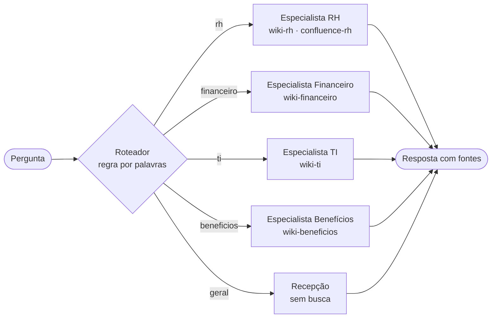

# Nota de arquitetura · Encontro 4

**Equipe:**
**Integrantes:**

> Uma página. A pergunta é uma só: **a divisão em vários agentes se paga no caso da Aurora?** Decidir **não** dividir, com números, é uma resposta tão válida quanto dividir.

## 1. O padrão escolhido

<!-- Nomeie o padrão: agente único com ferramentas, roteador + especialistas, ou supervisor + especialistas.
     Diga a configuração: roteador (llm ou regra), equipe (3 ou 4), handoff, o que fazer quando o roteador está incerto. -->

**Padrão:** roteador + especialistas.

**Configuração:** roteador por regra (palavras-chave, sem chamada ao modelo), 4 especialistas (RH, TI, Benefícios e Financeiro, mais a recepção sem busca), handoff com a pergunta original e, quando o roteador está incerto, seguir com a melhor rota. Não devolvemos ao agente único, porque isso desfaz a parede de acesso por fonte.

## 2. O diagrama

<!-- Ajuste o diagrama ao padrão escolhido. O GitHub desenha blocos mermaid sozinho.
     Mostre quem chama quem e que espaços da wiki cada agente enxerga. -->



## 3. O placar

<!-- Cole aqui a tabela que o Passo 4 do notebook 02 imprime. Precisa ter a linha de base (agente único)
     e pelo menos duas configurações. -->

| arquitetura | acertos | rota certa | chamadas/caso | tokens/caso | custo total (US$) | custo/acerto (US$) | seg/caso |
|---|---|---|---|---|---|---|---|
| agente único (Aula 3) | 16/19 | 17/17 | 2.6 | 3007 | 0.0655 | 0.00409 | 2.7 |
| roteador llm · 3 esp · original · incerto→segue | 16/19 | 14/17 | 3.1 | 2588 | 0.0599 | 0.00375 | 3.2 |
| roteador llm · 4 esp · original · incerto→segue | 16/19 | 14/17 | 3.1 | 2576 | 0.06 | 0.00375 | 3.3 |
| roteador llm · 3 esp · resumo · incerto→segue | 16/19 | 14/17 | 3.1 | 2581 | 0.0598 | 0.00374 | 3.1 |
| roteador llm · 4 esp · resumo · incerto→segue | 16/19 | 14/17 | 3.5 | 3230 | 0.0729 | 0.00455 | 3.5 |
| roteador llm · 4 esp · resumo · incerto→único | 15/19 | 14/17 | 3.8 | 3947 | 0.0869 | 0.00579 | 3.7 |
| roteador llm · 3 esp · resumo · incerto→único | 15/19 | 14/17 | 3.5 | 3291 | 0.074 | 0.00493 | 3.4 |
| roteador regra · 3 esp · original · incerto→único | 15/19 | 16/17 | 2.6 | 3081 | 0.0669 | 0.00446 | 2.6 |
| roteador regra · 4 esp · original · incerto→único | 15/19 | 16/17 | 2.6 | 3059 | 0.0667 | 0.00444 | 2.7 |
| roteador regra · 3 esp · original · incerto→segue | 16/19 | 14/17 | 2.0 | 2279 | 0.0506 | 0.00316 | 2.1 |
| supervisor · 3 esp | 17/19 | 15/17 | 3.9 | 3370 | 0.079 | 0.00465 | 4.2 |
| **⭐ roteador regra · 4 esp · original · incerto→segue** | **17/19** | 15/17 | **1.7** | **1360** | **0.0326** | **0.00192** | **1.9** |
| supervisor · 4 esp | 16/19 | 14/17 | 4.4 | 4218 | 0.0957 | 0.00598 | 4.7 |

## 4. A divisão se paga?

<!-- Três a cinco frases. Respondam com números do placar:
     - O acerto subiu, caiu ou ficou igual em relação ao agente único? E o custo por acerto?
     - O limite entre os especialistas é real (fonte, permissão, ferramenta próprias) ou é só um prompt diferente?
     - Que exigência do caso a divisão atende, ou deixa de atender (controle de acesso por fonte, auditabilidade)? -->

Escolhemos o roteador por regra com 4 especialistas, pergunta original e seguir quando há incerteza. Ele acertou 17/19, contra 16/19 do agente único, e custou US$ 0,00192 por acerto contra US$ 0,00409, ou seja, cerca de 2,1 vezes menos. O custo total caiu de US$ 0,0655 para US$ 0,0326, com 1360 tokens por caso contra 3007 e 1,9 segundo por caso contra 2,7. Ele passou a acertar S1 e S2, perguntas sem resposta na wiki em que o agente único escalou em vez de dizer que não sabia, e passou a errar o R1, que o agente único acertava. O supervisor com 3 especialistas também chegou a 17/19, mas custou US$ 0,00465 por acerto, cerca de 2,4 vezes mais que a nossa escolha. A divisão tem um limite real: cada especialista tem uma ferramenta de busca presa aos espaços da própria área, e isso sustenta o controle de acesso por fonte. As configurações que devolvem ao agente único nos casos incertos caíram para 15/19 e abrem mão dessa parede. A rota certa ficou em 15/17 contra 17/17 do agente único, e o R1 mostra por quê: a pergunta tocava duas áreas e o roteador mandou só para uma. Se perguntas de duas áreas passarem a ser frequentes, trocaríamos para o supervisor, que custa mais mas pode consultar mais de um especialista na mesma pergunta.

## 5. Um caso, aberto

<!-- O caso do Passo 3 do notebook 02. -->

**Caso:** R1, viagem ao Rio com pernoite e a VPN que não conecta no Wi-Fi do hotel.
**Causa:** pergunta de duas áreas. O roteador por regra escolhe um único especialista, e o Financeiro não enxerga a wiki-ti.
**A linha do trace que mostra a causa:**

```
[roteador] → financeiro (confiança alta)  · palavras: ['vpn', 'wi-fi', 'viajar', 'hotel', 'alimentacao']
[especialista financeiro] acessa: wiki-financeiro
resultado: ERROU (não citou ti-vpn-e-acesso-remoto)
```

## 6. Para o domínio da equipe (opcional)

<!-- Só para quem trocou o caso pelo domínio da própria empresa: em duas ou três frases, onde ficariam
     os limites entre especialistas no domínio de vocês, e que fonte cada um poderia ou não enxergar. -->
